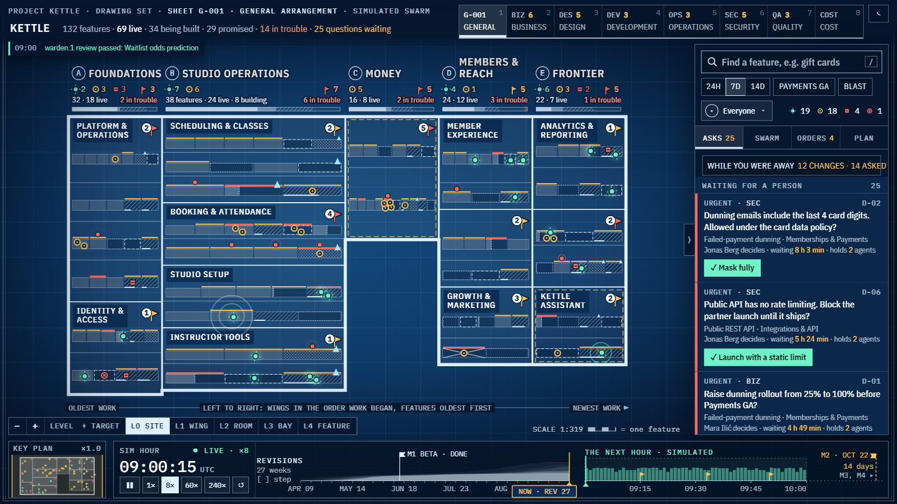
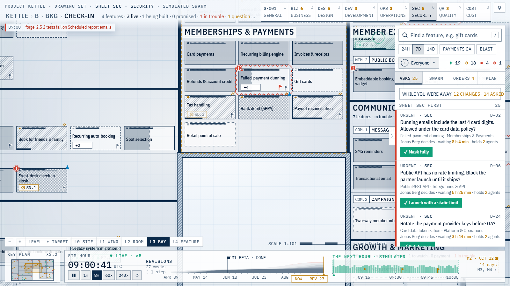

# bp: the product blueprint

A canvas that draws a whole software product as an architect's drawing set: domains as wings,
capabilities as rooms, and features as fixtures. Stage and health are readable at any zoom, and each
person reads the plan through their own lens. On top of the plan, a simulated swarm of AI agents
builds the product. People watch the swarm, answer its questions where they arise, and steer it.

This is the standalone home of the blueprint. Integrations with Personas and other apps will take
subsets of it later. **Status: a working prototype. The design and the product are far from final.**

| General view, dark theme | Security lens, light theme |
|---|---|
|  |  |
| *Whole product at site zoom: five wings, per-wing health counts, and the people-questions queue on the right.* | *Same plan zoomed to one bay under the Security lens: fixtures show the lens's marks, and the questions queue is filtered to security.* |

All data is sample data (a fictional product, *Kettle*, with 132 features), and the swarm is a
simulation.

## Run it

```sh
npm install
npm run dev            # http://localhost:3000
npm run build && npm start
```

bp is an npm workspace (`apps/*`, `packages/*`). The Next app lives in `apps/web` and is always started from the
repo root (`next dev apps/web`), so the server's working directory is the root, where `bp.products.local.json` lives.

| Route | What |
|---|---|
| `/` | The blueprint, with the adopted *subtle* lens expression |
| `/variants` | The three lens expressions (subtle, shaped, bold) for comparison |
| `?theme=light` | The light theme (a toggle in the header too) |
| `?scale=4` | Four product lines, 528 features: the scale test |
| `?lenses=-security,+com.kettle.cost` | Switch lenses off or on for the session |
| `?product=<slug>` | A live product: a repo listed in `bp.products.local.json`, read from its lens-scan store |

## Live products

A real product repo can be opened next to the Kettle sample. The `/lens-scan` skill (ai-registry) measures
the repo per lens and writes `<repo>/.ai/lens-scan/` (`app-structure.json`, `scan.db`, `shots/`). List the
repo in `bp.products.local.json` (shape: `bp.products.example.json`) and open `/?product=<slug>`: the scan
drives the swarm layer live, its proposals wait in the queue for Approve or Decline, and lens panels show
metric history. `node scripts/scan-demo.mjs [--live]` seeds a demo product (`kettle-live`) without a real
scan. Details: `docs/blueprint-ui.md` (Live products) and `docs/standard/app-structure-v3.md` §15.

Keys: `/` search · `1`–`9` lenses (1 = General) · `+` `−` zoom · arrows walk rooms · Enter opens · Esc goes back.

## What is where

```
apps/web/                      the Next.js app (npm workspace @bp/web); run from the repo root: npm run dev
apps/web/src/app/              routes: / (blueprint), /variants, /v/[variant]
apps/web/src/engine/           canvas engine: camera, frame loop, levels of detail, cached plan raster, lens mix
apps/web/src/components/       React UI around the canvas (header, dock, queue, feature sheet, legend, phone view)
apps/web/src/variants/         lens expressions: subtle (adopted), shaped, bold
apps/web/src/lib/standard/     app-structure v3: types, loader, health-rule evaluator, built-in lens catalog
apps/web/src/lib/model/        derived model: layout, aggregates, search, swarm simulation
apps/web/src/data/             fixtures: kettle.app-structure.json + kettle.events.jsonl (the product, v3),
                               swarm.json (the simulated swarm), kettle.json (the original sample)
docs/blueprint-ui.md           the UI contract: levels, 12 px text floor, performance rules, lenses as data
docs/standard/                 app-structure v3: spec, analysis, JSON Schemas, lens manifests, Personas brief
docs/research/users.md         the user analysis: eight people, eleven moments of use
docs/contest-history.md        how the design was chosen, with the owner's verbatim verdicts
docs/fixtures/kettle-sample.md field reference for the original sample
prototypes/                    the two static HTML contest winners the app descends from
scripts/                       fixture generators, v3 conversion, validator, perf and screenshot probes
```

## Data: app-structure v3

The app reads one file per product: `apps/web/src/data/kettle.app-structure.json`, plus an append-only events
log. The format is a superset of Personas' `context-map.json` v2. It adds a product tree, features
with a lifecycle stage, milestones and KPIs. **Lenses are plugins:** each one is a manifest with
fields, health rules written as JSON (no code runs), and presentation hints. A project can add its
own lens or switch any lens off. The spec is `docs/standard/app-structure-v3.md`.

```sh
npm run data:kettle-v3                 # rebuild the v3 map + events from apps/web/src/data/kettle.json
npm run validate:structure -- apps/web/src/data/kettle.app-structure.json --events apps/web/src/data/kettle.events.jsonl
npm run check:lens-health              # built-in lens rules vs the sample's stored health (gate: 132/132, every lens 100%)
npm run check:data                     # the committed apps/web/src/data map + events are exactly what data:kettle-v3 generates (writes nothing)
node scripts/fixtures/gen-kettle.mjs <dir>   # regenerate the original sample (deterministic)
node scripts/fixtures/gen-swarm.mjs <dir>    # regenerate the swarm over it
```

## Checks

`npm run check` runs typecheck, every `check:*` script in package.json (new ones join automatically)
and `validate:structure`, prints one line each with time and pass/fail, and exits 1 on any failure.
`check:route-guards` asserts every `apps/web/src/app/api/**/route.ts` handler opens with `localHost` (GET) or `localOnly`
(+ `jsonOnly` before a body parse); known gaps are listed in the script and reported on each run.
`check:python-deps` needs Python and is skipped (and reported as skipped) when `python` is not on PATH.
The production build warns "Dynamic filesystem access causes tracing of the whole project" for the
products shots route; that is expected and not a check failure.

`npm run typecheck` · `npm run build` · `python scripts/perf.py` (frame times while zooming at
`?scale=4`; the budget is 60 fps, see `docs/perf.md`) · `python scripts/shots.py` (screenshots).
The Python tools need `pip install -r requirements-tools.txt && playwright install chromium`, and a running server; they target `http://localhost:3000`
(`npm run dev` / `npm start`), or `$BP_BASE` / a URL argument for another port.

Stack: Next.js 16, React 19, Motion, TypeScript, and a canvas renderer with no other runtime
dependencies.
