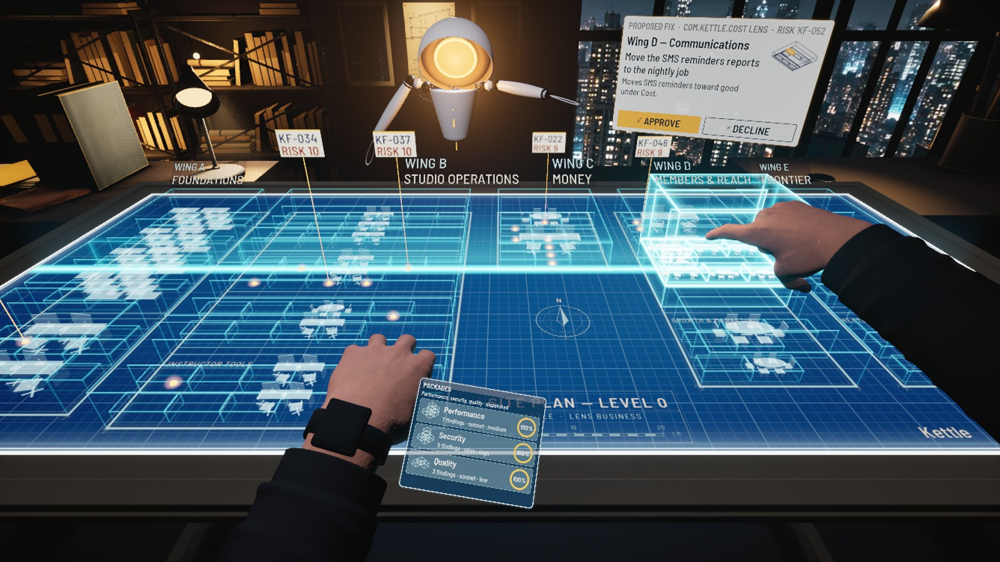
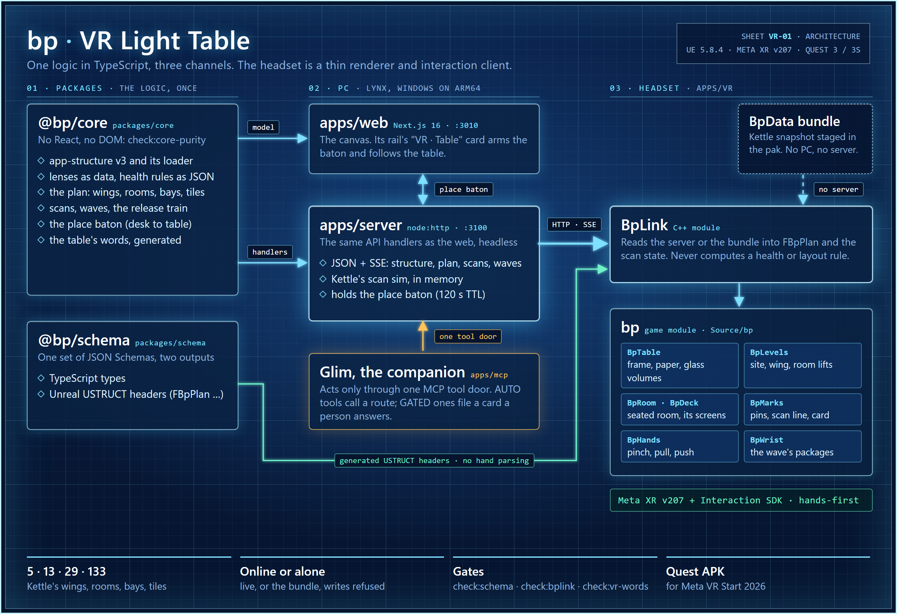

# bp: the product blueprint

A canvas that draws a whole software product as an architect's drawing set: domains as wings,
capabilities as rooms, and features as fixtures. Stage and health are readable at any zoom, and each
person reads the plan through their own lens. On top of the plan, a simulated swarm of AI agents
builds the product. People watch the swarm, answer its questions where they arise, and steer it.

This is the standalone home of the blueprint. Integrations with Personas and other apps will take
subsets of it later. **Status: a working prototype. The design and the product are far from final.**

| General view, dark theme | Security lens, light theme |
|---|---|
|  |  |
| *Whole product at site zoom: five wings, per-wing health counts, and the people-questions queue on the right.* | *Same plan zoomed to one bay under the Security lens: fixtures show the lens's marks, and the questions queue is filtered to security.* |

All data is sample data (a fictional product, *Kettle*, with 132 features), and the swarm is a
simulation.

## Run it

```sh
npm install
npm run dev            # http://localhost:3010
npm run build && npm start
npm run server         # the API alone, headless (apps/server): http://127.0.0.1:3100, JSON + SSE
```

bp is an npm workspace (`apps/*`, `packages/*`). The Next app lives in `apps/web` and is always started from the
repo root (`next dev apps/web -H 127.0.0.1`, loopback only), so the server's working directory is the root, where `bp.products.local.json` lives.

| Route | What |
|---|---|
| `/` | The blueprint, with the adopted *subtle* lens expression |
| `/variants` | The three lens expressions (subtle, shaped, bold) for comparison |
| `?theme=light` | The light theme (a toggle in the header too) |
| `?scale=4` | Four product lines, 528 features: the scale test |
| `?lenses=-security,+com.kettle.cost` | Switch lenses off or on for the session |
| `?product=<slug>` | A live product: a repo listed in `bp.products.local.json`, read from its lens-scan store |
| `?product=<slug>&page=ledger&tab=release` | That product's findings ledger at the Release tab (`tab=triage` / `matrix` for the others); the link Personas' Release card opens. bp reads it once into its hash state and drops it from the query |

## Live products

A real product repo can be opened next to the Kettle sample. The `/lens-scan` skill (ai-registry) measures
the repo per lens and writes `<repo>/.ai/lens-scan/` (`app-structure.json`, `scan.db`, `shots/`). List the
repo in `bp.products.local.json` (shape: `bp.products.example.json`) and open `/?product=<slug>`: the scan
drives the swarm layer live, its proposals wait in the queue for Approve or Decline, and lens panels show
metric history. `node scripts/scan-demo.mjs [--live]` seeds a demo product (`kettle-live`) without a real
scan, every reading projected from the Kettle map and its lens manifests, with Kettle's sample release train (three packs, built items to triage, a draft release); `node scripts/smoke-live.mjs [base]` seeds it and walks every product route against a running server. Details: `docs/blueprint-ui.md` (Live products) and `docs/standard/app-structure-v3.md` §15.

Keys: `/` search · `1`–`9` lenses (1 = General) · `+` `−` zoom · arrows walk rooms · Enter opens · Esc goes back.

## Running under Personas

With the Personas desktop app as the one point of control (spark one-control), three server env vars (set them in
`.env.local`, then restart `npm run dev`) hand bp's work to it:

| Env var | What it does |
|---|---|
| `BP_RUNNER=personas` | Every scan, execute and release job runs through the Personas fleet shim instead of a `claude` of its own, so it waits in the Personas fleet's one queue (its cap and budgets) and shows in its Fleet Monitor as origin `lens_scan`, labelled `bp-job:<id>`. The Personas app must be running (the shim reads its local handshake). The onboarding chat still runs `claude` itself. An explicit `BP_CLAUDE_BIN` still wins. |
| `PERSONAS_RUN_SHIM` | Where the shim is. Default: `<bp root>/../personas/scripts/fleet/personas-run.mjs` (the sibling checkout). A job fails with "Personas fleet shim not found" when neither exists. |
| `BP_WRITES=off` | Read-only decisions: the approve / decline, dispatch, lens execute and triage controls are hidden and their routes answer 403 naming the flag. Scans, lens edits and the whole Release tab stay live (bp composes releases). Nothing is deleted; the default is writes on. |

Every decision bp writes (approve, decline, the approvals a dispatch or lens execute makes, triage, a release) is signed
`user:<gh login>` (`gh api user --jq .login`, once per server process; `user:blueprint` when gh is missing or signed out).
## The companion's API

bp's companion acts only through one tool door: `apps/mcp/bp-mcp.mjs`, a stdio MCP server (`node apps/mcp/bp-mcp.mjs`,
env `BP_URL`, default `http://127.0.0.1:3100`) whose tools are the catalog in `packages/core/src/companion/catalog.ts`.
Each tool is one HTTP call to bp. An AUTO tool (reversible, not external) calls its route; a GATED one files a card that
only a person answers (or a policy grant the person wrote covers). Routes (handlers in `packages/core/src/server/api/companion`,
contracts in their headers and in `docs/blueprint-ui.md`):

| Route | What |
|---|---|
| `GET /api/companion/inbox?limit=50` | Open decisions across every registered product, ranked; `{ items, skipped }` |
| `POST /api/companion/recommendations` | A recommended verdict on one decision, for batch approval |
| `GET /api/companion/gaps?product=&limit=20` | Where coverage is lacking (unmeasured, stale, unknown, deviation), scored and ranked |
| `GET` `POST /api/companion/cards` | The cards, newest first; file a card for a GATED tool (the MCP door's path) |
| `POST /api/companion/cards/<id>` | Approve or decline a card: the human path (`x-bp-human` token) |
| `GET` `POST /api/companion/policies`, `DELETE /api/companion/policies/<id>` | Scoped, expiring grants; writes are the human path |
| `GET` `POST /api/companion/focus` | Show the person a place; `?since=<id>` is VR's poll (`docs/concepts/vr-light-table/companion-link.md`) |
| `GET /api/companion/human-token` | The human path's token, only to bp's own page (`Sec-Fetch-Site: same-origin`, `Sec-Fetch-Mode: cors`) |

The companion's state lives under `$BP_HOME/companion` (default `<repo>/.bp/companion`, git-ignored). `node
scripts/check-companion-door.ts` walks the door end to end.

## VR: the Light Table

bp's third channel, after the web canvas and the phone view: the same product, lenses, scans and waves, drawn at a
backlit drafting table in a dark studio for a Meta Quest. Wings lie on the glass left to right, rooms rise off the paper
as glass extrusions, a scan line sweeps and amber pins rise over findings, the left wrist carries the wave's packages,
and the agent, a drafting lamp, floats the one decision it needs beside it: approve or decline.

| The target: concept art | Where it stands: the table in Unreal 5.8 |
|---|---|
|  |  |
| *A generated concept image. Its labels are image-model text and mean nothing.* | *An in-engine capture: Kettle's five wings, its findings as pins, a real decision card and the wave's packages on the wrist.* |

**Status:** a UE 5.8.4 project with Meta XR v207 and the Interaction SDK, built on Lynx (Windows on ARM64). Hands-first
levels (pinch and pull to dive, push to go back), room mode with a deck of decision screens, the wrist panel and the lamp
run against `apps/server` or a bundled snapshot. The Quest APK builds (package `com.developersblueprint.vr`), aimed at the
Meta VR Start Developer Competition (entries close 2026-11-18). The web app's *Take it to the table* crossing and its place
baton are on master; the VR half of the crossing is next.

### Architecture



*Drawn in HTML and CSS (`docs/img/src/vr-architecture.html`); `python docs/img/src/render.py` re-renders the PNG.*

- **One logic, three channels.** Every rule (health, layout, the derived plan) lives in TypeScript in `packages/core`.
  The Unreal app is a thin renderer and interaction client: it reads the plan (5 wings, 13 rooms, 29 bays, 133 tiles for
  Kettle) and never computes a health or layout rule.
- **The contract is generated.** `packages/schema` emits the Unreal `USTRUCT` headers from the same JSON Schemas as the
  TypeScript types, so `FJsonObjectConverter` fills them with no hand-written parsing; `check:schema` keeps them fresh,
  `check:bplink` guards the routes BpLink calls and `check:vr-words` keeps the table's words equal to the web's.
- **Online or alone.** BpLink reads `apps/server` (`/structure`, `/plan`, the scan side, `/stream`), or, on a headset
  with no PC, the Kettle snapshot `apps/vr/tools/bundle-data.mjs` stages into the build. On the bundle, writes are
  refused with a log line. A paired LAN door for the live table is designed (standalone plan, S8).
- **The `bp` game module** (`apps/vr/Source/bp`): `BpTable` (frame, paper, edge-glow volumes from `FBpPlan`),
  `BpLevels` (site → wing → room lifts), `BpRoom` / `BpDeck` / `BpSwitch` (seated room mode and its screens),
  `BpMarks` (pins, scan line, decision card), `BpWrist` (packages), `BpHands` (pinch-pull-push, tracking loss as a
  state), `BpHeadset` (seated calibration, text card in arcmin, the 90 Hz frame meter).
- **Content is made by agents.** The level and assets are built through UE 5.8's editor MCP (`apps/vr/tools/mcp-*.mjs`,
  every call logged in `tools/mcp-steps/`), with art sources and evidence shots in `apps/vr/ArtSource/`.

Start with [`docs/concepts/vr-light-table/README.md`](docs/concepts/vr-light-table/README.md) (decisions and the
document index), [`apps/vr/README.md`](apps/vr/README.md) (how to run it on Lynx),
[`standalone-plan.md`](docs/concepts/vr-light-table/standalone-plan.md) (the Quest APK) and
[`docs/concepts/desk-to-table/plan.md`](docs/concepts/desk-to-table/plan.md) (the crossing from the desk to the table).

## What is where

```
apps/web/                      the Next.js app (npm workspace @bp/web); run from the repo root: npm run dev
apps/web/src/app/              routes: / (blueprint), /variants, /v/[variant]
apps/web/src/engine/           canvas engine: camera, frame loop, levels of detail, cached plan raster, lens mix
apps/web/src/components/       React UI around the canvas (header, dock, queue, feature sheet, legend, phone view)
apps/web/src/variants/         lens expressions: subtle (adopted), shaped, bold
apps/web/src/lib/              the web-only half of the logic: the live client and project store (React), scan
                               actions and temporary lenses (browser), scan views (engine) and live steering
apps/server/                   the headless server (@bp/server): node:http mounting the same API handlers, no Next
packages/core/                 the logic, once (npm workspace @bp/core; no React, DOM or Next: check:core-purity)
packages/core/src/standard/    app-structure v3: types, loader, health-rule evaluator, built-in lens catalog
packages/core/src/model/       derived model: layout, aggregates, search, swarm simulation
packages/core/src/scan/        lens-scan store types, jobs, waves, release, scopes (pure)
packages/core/src/train/       the release train's rules, wire parsers and comparisons (pure)
packages/core/src/data/        the data types, the map loader and the Kettle sample loader
packages/core/src/server/      the Node-only half: store, products registry, job runner, git and release (*.server.ts)
packages/core/data/            fixtures: kettle.app-structure.json + kettle.events.jsonl (the product, v3),
                               swarm.json (the simulated swarm), kettle.json (the original sample)
packages/schema/               app-structure v3 JSON Schemas + generators: TypeScript types and Unreal USTRUCTs
apps/mcp/                      the companion's one tool door (stdio MCP server over bp's HTTP API)
apps/vr/                       the Unreal 5.8 VR Light Table: bp.uproject, Source/BpLink (the server link),
                               Source/bp (the table), Content/, ArtSource/, tools/ (setup, run, MCP, packaging)
docs/concepts/vr-light-table/  the VR concept, plans, machine readings and captures
docs/concepts/desk-to-table/   the crossing from the web app into the table
docs/blueprint-ui.md           the UI contract: levels, 12 px text floor, performance rules, lenses as data
docs/standard/                 app-structure v3: spec, analysis, lens manifests, Personas brief
docs/research/users.md         the user analysis: eight people, eleven moments of use
docs/contest-history.md        how the design was chosen, with the owner's verbatim verdicts
docs/fixtures/kettle-sample.md field reference for the original sample
prototypes/                    the two static HTML contest winners the app descends from
scripts/                       fixture generators, v3 conversion, validator, perf and screenshot probes
```

## Data: app-structure v3

The app reads one file per product: `packages/core/data/kettle.app-structure.json`, plus an append-only events
log. The format is a superset of Personas' `context-map.json` v2. It adds a product tree, features
with a lifecycle stage, milestones and KPIs. **Lenses are plugins:** each one is a manifest with
fields, health rules written as JSON (no code runs), and presentation hints. A project can add its
own lens or switch any lens off. The spec is `docs/standard/app-structure-v3.md`.

```sh
npm run data:kettle-v3                 # rebuild the v3 map + events from packages/core/data/kettle.json
npm run validate:structure -- packages/core/data/kettle.app-structure.json --events packages/core/data/kettle.events.jsonl
npm run check:lens-health              # built-in lens rules vs the sample's stored health (gate: 132/132, every lens 100%)
npm run check:data                     # the committed packages/core/data map + events are exactly what data:kettle-v3 generates (writes nothing)
node scripts/fixtures/gen-kettle.mjs <dir>   # regenerate the original sample (deterministic)
node scripts/fixtures/gen-swarm.mjs <dir>    # regenerate the swarm over it
```

## Checks

`npm run check` runs typecheck, every `check:*` script in package.json (new ones join automatically)
and `validate:structure`, prints one line each with time and pass/fail, and exits 1 on any failure.
`check:route-guards` asserts every API handler (`packages/core/src/server/api/**/route.ts`) opens with `localHost` (GET) or
`localOnly` (+ `jsonOnly` before a body parse), and that every `apps/web/src/app/api/**/route.ts` is a thin mount re-exporting
exactly its core handler; known gaps are listed in the script and reported on each run.
`check:core-purity` fails when `packages/core` imports React, Next or Motion, the web app (`@/`, `apps/`), or (outside
`src/server`) a Node built-in or a server file, when its pure half does not typecheck without the DOM lib, or when `apps/web` reaches
core by a relative path instead of `@bp/core/*`; seeded controls prove each rule red on every run.
`check:schema` fails when `packages/schema/generated/` (the TypeScript types and the Unreal header) is stale against the
schemas; `npm run schema:generate` rewrites both. `check:server` starts apps/server and compares its routes with the web mounts.
`check:python-deps` needs Python and is skipped (and reported as skipped) when `python` is not on PATH.
The production build warns "Dynamic filesystem access causes tracing of the whole project" for the
products shots route; that is expected and not a check failure.

`npm run typecheck` · `npm run build` · `python scripts/perf.py` (frame times while zooming at
`?scale=4`; the budget is 60 fps, see `docs/perf.md`) · `python scripts/shots.py` (screenshots).
The Python tools need `pip install -r requirements-tools.txt && playwright install chromium`, and a running server; they target `http://localhost:3010`
(`npm run dev` / `npm start`), or `$BP_BASE` / a URL argument for another port.

Stack: Next.js 16, React 19, Motion, TypeScript, and a canvas renderer with no other runtime
dependencies.
