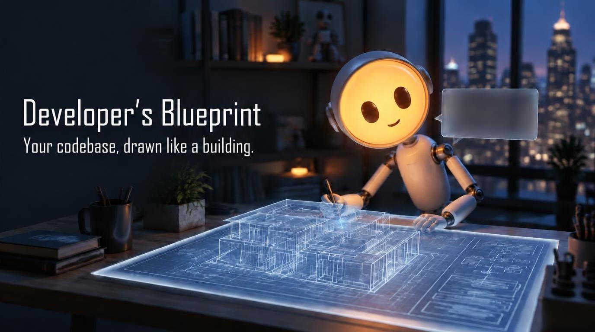
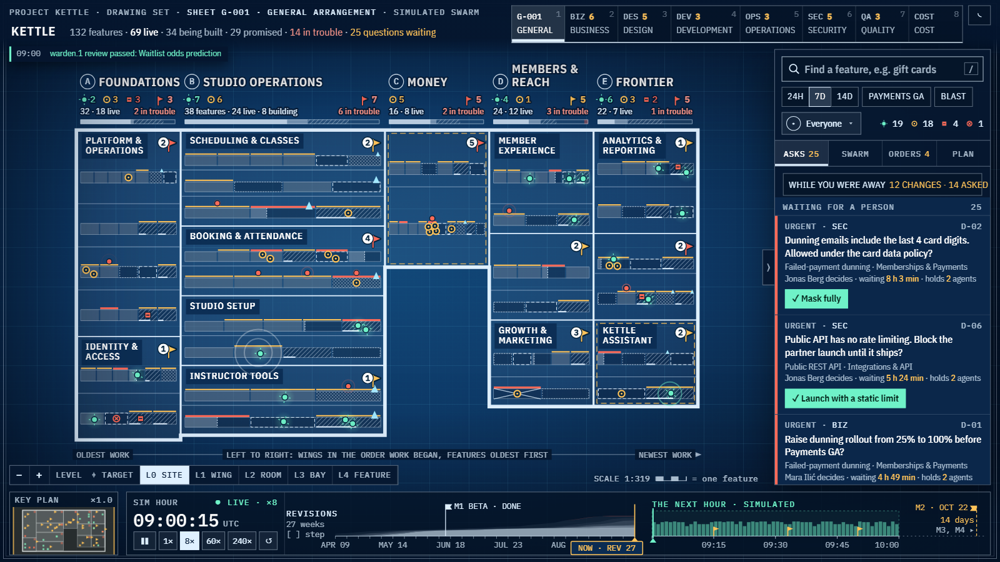
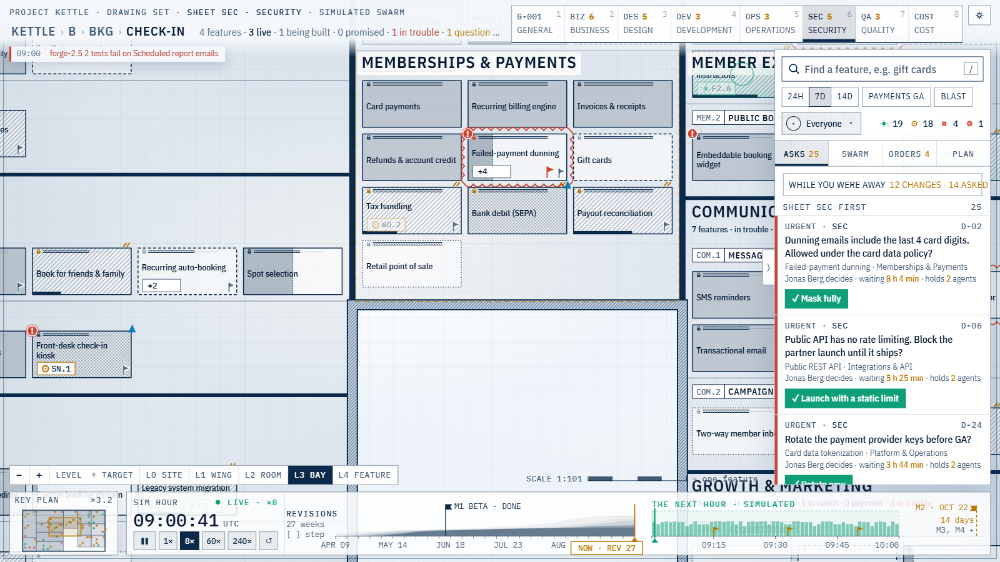
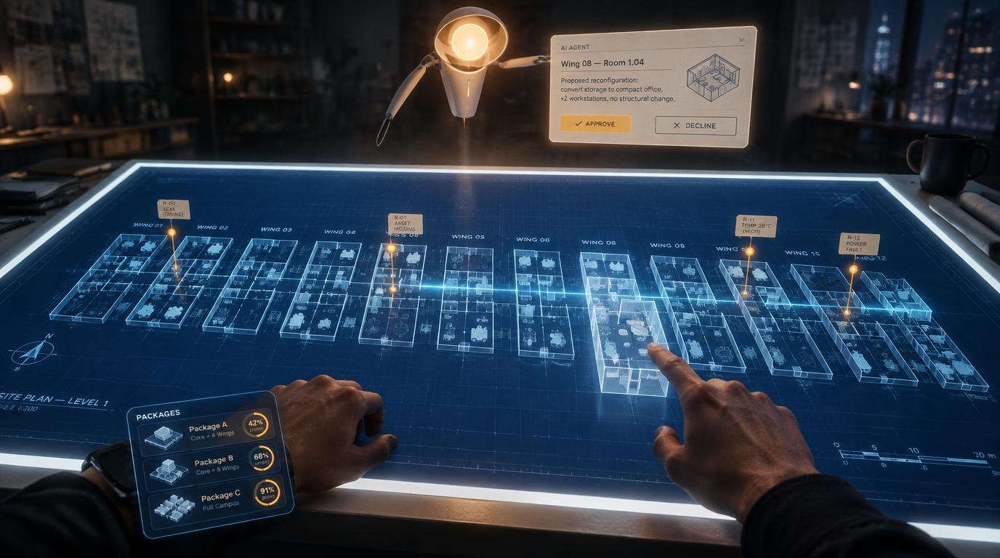
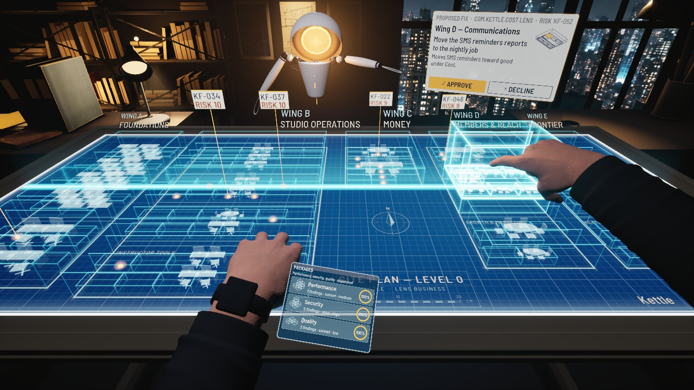
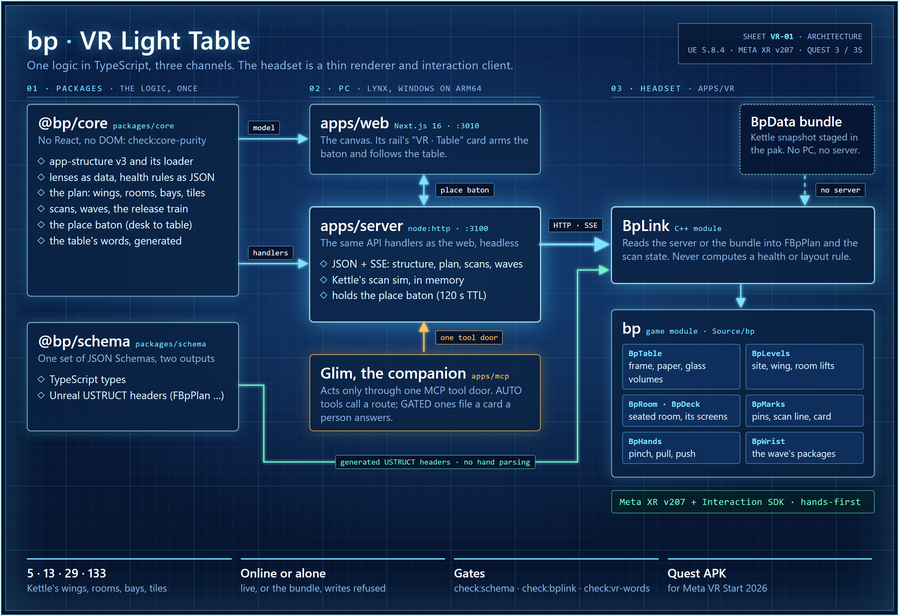

# bp: Developer's Blueprint



A canvas that draws a whole software product as an architect's drawing set: domains as wings,
capabilities as rooms, and features as fixtures. Stage and health are readable at any zoom, and each
person reads the plan through their own lens. On top of the plan, a swarm of AI agents builds the
product; people watch it, answer its questions where they arise, and steer it.

bp has three channels over one logic: the **web app** (a canvas, plus a phone view), the **headless server**
the other channels read, and the **VR Light Table**, an Unreal Engine 5.8 app for Meta Quest 3 and 3S. A build of
the VR app was submitted to the Meta VR Start Developer Competition on 2026-11-18. **Status: a working prototype. The
design and the product are far from final.**

| General view, dark theme | Security lens, light theme |
|---|---|
|  |  |
| *Whole product at site zoom: five wings, per-wing health counts, and the people-questions queue on the right.* | *Same plan zoomed to one bay under the Security lens: fixtures show the lens's marks, and the questions queue is filtered to security.* |

Everything runs out of the box on a built-in sample product, *Kettle* (fictional, 132 features), with a simulated
swarm. No API key and no account is needed to run the web app, the server or the VR app on the sample.

## Contents

- [Quick start: web](#quick-start-web)
- [Quick start: VR](#quick-start-vr)
- [Live products](#live-products)
- [The VR Light Table](#the-vr-light-table)
- [Repository layout](#repository-layout)
- [Data: app-structure v3](#data-app-structure-v3)
- [Checks](#checks)
- [License](#license)

## Quick start: web

**Needs:** [Node.js](https://nodejs.org) 22.18 or later (`engines` in `package.json`; the server runs TypeScript
directly) and npm.

```sh
npm install                 # once, at the repo root (an npm workspace: apps/*, packages/*)
npm run dev                 # development server: http://127.0.0.1:3010
```

or the production build:

```sh
npm run build               # next build apps/web
npm start                   # http://127.0.0.1:3010
```

Open **http://127.0.0.1:3010**. You see Kettle's blueprint. Both commands bind to loopback only, and both must run
from the repo root (the root is the server's working directory, where `bp.products.local.json` is read).

**The headless server** (`apps/server`) serves the same API without Next, as JSON and server-sent events. The VR app
reads it, and the web app can share its companion:

```sh
npm run server              # http://127.0.0.1:3100 (--port / --host, or BP_SERVER_PORT / BP_SERVER_HOST)
npm run server -- --pair    # also accept a headset pairing over the USB cable
npm run server -- --lan     # also open the LAN door for paired headsets on Wi-Fi (port 3101, --lan-port)
```

| Route | What |
|---|---|
| `/` | The blueprint (the *subtle* lens expression) |
| `/variants`, `/v/subtle`, `/v/shaped`, `/v/bold` | The three lens expressions, side by side or one at a time |
| `/projects` | The repositories bp can draw: add one and onboard it, rename, move or remove it |
| `/projects/[slug]/onboarding` | A project being onboarded: its plan drawn as the run learns it |
| `/headsets` | The VR headsets paired with this PC: pair by the code the headset shows, set what it may do, revoke |
| `/crossing` | The crossing from the web blueprint to the VR table, as a web prototype (sample data) |
| `/buildup` | The onboarding build-up lab |
| `?theme=light` · `?scale=4` · `?lenses=-security,+com.kettle.cost` | Light theme · four product lines (528 features, the scale test) · lenses off or on for the session |
| `?product=<slug>` | A live product (below) instead of Kettle |

Keys: `/` search · `1`–`9` lenses (1 = General) · `+` `−` zoom · arrows walk rooms · `N` / `Shift+N` step through the
features in trouble under the lens · `A` pins a baseline date to compare with · Enter opens · Esc goes back.

### Environment variables

None is required. Set them in the shell that starts the process.

| Variable | Read by | What it does |
|---|---|---|
| `BP_SERVER_PORT`, `BP_SERVER_HOST` | server | Port (default 3100) and bind host (default `127.0.0.1`) |
| `BP_COMPANION_URL` | web | Hand the companion and session routes to a running `npm run server` (e.g. `http://127.0.0.1:3100`), so the desk and a headset share one companion. Needed for the `/headsets` page to pair a headset. Read by `next.config.ts`: set it for `npm run dev`, or when running `npm run build` |
| `BP_HOME` | both | Where bp keeps its local state (companion, pairings, session). Default `<repo>/.bp`, git-ignored |
| `BP_PRODUCTS_FILE` | both | The live-product registry. Default `<repo>/bp.products.local.json` (git-ignored; shape: `bp.products.example.json`) |
| `BP_CLAUDE_BIN` | both | The Claude Code CLI that runs scans, onboarding and the companion. Default `claude` on `PATH`. Only live products and the companion need it |
| `BP_WRITES=off` | both | Read-only decisions: approve, decline, dispatch and triage are hidden and their routes answer 403 |
| `ELEVEN_LABS_API_KEY` | both | The companion's cloud voice (text to speech and speech to text for the headset). Read from the environment or the repo root's git-ignored `.env`. Without it the companion is text only |
| `BP_CLOUD_SPEECH=off` | server | Refuse every speech-to-text call from a headset |

## Quick start: VR

The VR app is in `apps/vr` (`bp.uproject`, package `com.developersblueprint.vr`). It runs on a Quest by itself, on the
bundled Kettle sample, with no PC. Linked to a PC running `npm run server`, it reads that server live.

### Get the headset ready (once)

1. **Developer mode:** in the Meta Horizon phone app, Devices → your headset → Headset settings → Developer mode. This
   needs a (free) Meta developer account.
2. **Hand tracking:** on the headset, Settings → Movement tracking → Hand and body tracking. The app is hands-first;
   controllers also work.
3. **adb** (Android platform-tools) on the PC. `apps/vr/tools/setup-android.ps1` (below) installs it; any platform-tools
   install works for sideloading.
4. Connect the headset by USB-C and accept **Allow USB debugging** inside the headset. `adb devices` should list it as
   `device`.

### Path A: install a packaged APK

This repository does not publish an APK; you get one from whoever built it, or by building it (path B). Then:

```sh
adb install -r bp-Android-Shipping-arm64.apk     # or bp-arm64.apk, the Development build
```

On the headset, open the app library, choose **Unknown Sources** in the source filter, and start **Developer's
Blueprint**. The first launch plays a short guided tour (about 90 s) with the companion lamp, Glim.

### Path B: build from source (Windows)

**Needs:** Windows 11 (x64, or ARM64 with the engine emulated), **Unreal Engine 5.8** from the Epic Games Launcher at
`C:\Program Files\Epic Games\UE_5.8` (it ships the editor-only plugins the project enables), Node.js 22.18+ with
`npm install` run at the repo root.

One-time setup, from the repo root in PowerShell:

```powershell
powershell -NoProfile -ExecutionPolicy Bypass -File apps/vr/tools/link-schema.ps1     # junction to the generated C++ schema headers
powershell -NoProfile -ExecutionPolicy Bypass -File apps/vr/tools/install-xr.ps1      # Meta XR v207 + Interaction SDK (+ XR Simulator), SHA-256 pinned
powershell -NoProfile -ExecutionPolicy Bypass -File apps/vr/tools/setup-android.ps1   # JDK 21, Android SDK 36, NDK r27c, adb; sets ANDROID_HOME, JAVA_HOME, NDKROOT
```

`install-xr.ps1` downloads Meta's official packages into git-ignored `apps/vr/Plugins/` and checks each against a pinned
hash; if Meta's download page asks for a login or a licence click it stops with exit code 3 (`OWNER_ACTION`) and tells
you what to do. `setup-android.ps1` installs per user, with no admin rights; open a new shell afterwards.

`bp.uproject` also enables `PoFToolset`, an editor-only plugin from a sibling checkout (`..\pof`, linked by
`apps/vr/tools/link-pof-toolset.ps1`) used only to make content through the editor's MCP. **If you don't have that
checkout, delete the `PoFToolset` entry from your local `bp.uproject`**; nothing in the game needs it.

Open the project with `apps/vr/tools/start-editor.ps1` (on ARM64 this is required: it gives the engine's build tools the
bundled x64 .NET; on x64, double-clicking `bp.uproject` also works). The first open compiles the C++ modules.

Package and install:

```powershell
powershell -NoProfile -ExecutionPolicy Bypass -File apps/vr/tools/package-quest.ps1                       # Development (default)
powershell -NoProfile -ExecutionPolicy Bypass -File apps/vr/tools/package-quest.ps1 -Config Shipping -Install
```

The APK lands in `apps/vr/.cache/quest/Android_ASTC/` (`bp-arm64.apk` for Development,
`bp-Android-Shipping-arm64.apk` for Shipping); the full log is `apps/vr/.cache/quest/uat.log`. `-Install` runs
`adb install -r` on the one connected headset; otherwise install it as in path A. The script fails the package if the
staged files miss the bundled sample, the tour's voice or the code-loaded assets.

**Shipping needs release signing.** A Shipping APK is signed with your release key and is not debuggable (what the
store requires). Create a keystore in the git-ignored `apps/vr/Build/Android/` (for example with `keytool -genkeypair`
from the JDK above), then put its settings in the **per-user**
`%LOCALAPPDATA%\Unreal Engine\Engine\Config\UserEngine.ini`, never in the project's `Config/`, which would be staged
into the package:

```ini
[/Script/AndroidRuntimeSettings.AndroidRuntimeSettings]
KeyStore=<file name in apps/vr/Build/Android>
KeyAlias=<alias>
KeyStorePassword=<password>
```

Without `KeyStorePassword` there, `-Config Shipping` refuses (exit 2). Development needs no signing setup.

### Offline, or linked to your PC

- **Offline (the default).** With no PC answering, the app reads the Kettle snapshot bundled into the APK
  (`apps/vr/Content/BpData/kettle/`, staged by `apps/vr/tools/bundle-data.mjs`). Scans are sample playbacks, writes are
  refused, and holding to talk plays a scripted exchange without opening the microphone.
- **Over the USB cable.** Run `npm run server` on the PC, then `node apps/vr/tools/quest-tether.mjs` (an
  `adb reverse` of port 3100). Within about 5 s the app moves from the sample to the PC's server, with no restart.
  `node apps/vr/tools/quest-tether.mjs --remove` takes it down again.
- **Pairing, then Wi-Fi.** Decisions from the headset need a pairing. Run `npm run server` and, in a second shell,
  the web app with `BP_COMPANION_URL=http://127.0.0.1:3100 npm run dev` (PowerShell:
  `$env:BP_COMPANION_URL='http://127.0.0.1:3100'; npm run dev`). Open
  `http://127.0.0.1:3010/headsets`, switch pairing on (**PAIR OVER THE CABLE**, or **TURN WI-FI ON** for the LAN door),
  then in the headset choose MENU → PC LINK → PAIR and type the 6-character code it shows into the page, tick what it
  may do and approve. With the Wi-Fi door on (the page's switch lasts until the server stops; `npm run server -- --lan`
  opens it at every start), a paired headset reaches the PC over the home network on port 3101, without the cable. The
  app picks the cable, then the saved Wi-Fi door, then the bundled sample. The command line works as well:
  `npm run server -- pair list | open | approve <code> --scope standup,place,focus | revoke <id>`.

The full guide, including the console commands and what each pairing scope grants, is
[`docs/concepts/vr-light-table/run-locally.md`](docs/concepts/vr-light-table/run-locally.md). To run the table on the PC
instead (Meta Horizon Link, the Meta XR Simulator, or flat), use `node apps/vr/tools/run-bplink.mjs` as described there.

## Live products

A real repository can be opened next to the Kettle sample. Add it on `/projects`, which checks the folder,
registers it in `bp.products.local.json` and starts its onboarding, then open `/?product=<slug>`. Live products are
measured by the `/lens-scan` skill (from the knowledge registry, run through the Claude Code CLI), which writes
`<repo>/.ai/lens-scan/`; their proposals wait in the queue for Approve or Decline.

Without a real scan, `node scripts/scan-demo.mjs [--live]` seeds a demo product (`kettle-live`) projected from the
Kettle sample, and `node scripts/smoke-live.mjs [base]` seeds it and walks every product route against a running
server. Details: [`docs/blueprint-ui.md`](docs/blueprint-ui.md) (Live products) and
[`docs/standard/app-structure-v3.md`](docs/standard/app-structure-v3.md) §15.

## The VR Light Table

The same product, lenses, scans and waves, drawn at a backlit drafting table in a dark studio. Wings lie on the glass
left to right, rooms rise off the paper as glass extrusions, a scan line sweeps and pins rise over findings, the left
wrist carries the wave's packages, and the companion, Glim, a drafting lamp, floats the one decision it needs beside it:
approve or decline. A console below the line of sight holds the rooms, scans, the morning stand-up, projects, settings,
the PC link and the tour.

| The target: concept art | The table in Unreal Engine 5.8 |
|---|---|
|  |  |
| *A generated concept image. Its labels are image-model text and mean nothing.* | *An in-engine capture: Kettle's five wings, its findings as pins, a real decision card and the wave's packages on the wrist.* |



- **One logic, three channels.** Every rule (health, layout, the derived plan) lives in TypeScript in `packages/core`.
  The Unreal app is a thin renderer and interaction client: it reads the plan (5 wings, 13 rooms, 29 bays, 133 tiles
  for Kettle) and never computes a health or layout rule.
- **The contract is generated.** `packages/schema` emits the Unreal `USTRUCT` headers from the same JSON Schemas as the
  TypeScript types; `check:schema` keeps them fresh, `check:bplink` guards the routes the headset calls and
  `check:vr-words` keeps the table's words equal to the web's.
- **Two modules.** `apps/vr/Source/BpLink` (the server link, the bundled-snapshot fallback, pairing and the app's saved
  settings) and `apps/vr/Source/bp` (the table, levels, rooms, console, wrist, hands, stand-up, tour, talk and audio).
- **Content is made by agents** through UE 5.8's editor MCP (`apps/vr/tools/mcp-*.mjs`, every call logged in
  `apps/vr/tools/mcp-steps/`), with art sources and evidence shots in `apps/vr/ArtSource/`.

The diagram is drawn in HTML (`docs/img/src/vr-architecture.html`); `python docs/img/src/render.py` re-renders it.
More: [`docs/concepts/vr-light-table/README.md`](docs/concepts/vr-light-table/README.md) (decisions and the document
index), [`standalone-plan.md`](docs/concepts/vr-light-table/standalone-plan.md) (the Quest APK),
[`voice-link.md`](docs/concepts/vr-light-table/voice-link.md) (how Glim speaks and listens, and what leaves the PC),
[`apps/vr/README.md`](apps/vr/README.md) (the build host's notes and history) and
[`docs/concepts/desk-to-table/plan.md`](docs/concepts/desk-to-table/plan.md) (the crossing from the desk to the table).

## Repository layout

```
apps/web/                      the Next.js app (@bp/web); run from the repo root: npm run dev
  src/app/                     routes: /, /variants, /v/[variant], /projects, /projects/[slug]/onboarding, /headsets,
                               /crossing, /buildup, and the API mounts under api/
  src/engine/                  canvas engine: camera, frame loop, levels of detail, cached plan raster, lens mix
  src/components/              React UI around the canvas (header, dock, queue, feature sheet, legend, phone view, companion)
  src/variants/                lens expressions: subtle (adopted), shaped, bold
apps/server/                   the headless server (@bp/server): the same API handlers on node:http, the LAN door, pairing
apps/mcp/                      the companion's one tool door (a stdio MCP server over bp's HTTP API)
apps/vr/                       the Unreal Engine 5.8 VR app: bp.uproject, Source/BpLink, Source/bp, Content/, Config/,
                               tools/ (setup, editor, packaging, tether, MCP)
packages/core/                 the logic, once (@bp/core; no React, DOM or Next: check:core-purity)
  src/standard/                app-structure v3: types, loader, health-rule evaluator, built-in lens catalog
  src/model/                   derived model: layout, aggregates, search, swarm simulation
  src/scan/, src/train/        lens-scan store types, jobs, waves, release train (pure)
  src/server/                  the Node-only half: store, products registry, job runner, companion, API handlers
  data/                        the Kettle sample: kettle.app-structure.json, kettle.events.jsonl, swarm.json
packages/schema/               app-structure v3 JSON Schemas + generators: TypeScript types and Unreal USTRUCTs
docs/                          blueprint-ui.md (the UI and API contract), standard/ (app-structure v3), concepts/ (VR,
                               desk-to-table, demo video), research/, perf.md
scripts/                       the checks (check-*.ts|mjs), fixture generators, demos, perf and screenshot probes
```

## Data: app-structure v3

The app reads one file per product, `packages/core/data/kettle.app-structure.json` for the sample, plus an append-only
events log. The format adds a product tree, features with a lifecycle stage, milestones and KPIs to a context map.
**Lenses are plugins:** each is a manifest with fields, health rules written as JSON (no code runs), and presentation
hints; a project can add its own lens or switch any off. The spec is
[`docs/standard/app-structure-v3.md`](docs/standard/app-structure-v3.md).

```sh
npm run data:kettle-v3       # rebuild the v3 map + events from packages/core/data/kettle.json
npm run validate:structure -- packages/core/data/kettle.app-structure.json --events packages/core/data/kettle.events.jsonl
npm run schema:generate      # regenerate packages/schema/generated/ (TypeScript types and the Unreal header)
```

## Checks

```sh
npm run check                # the gate: typecheck + every check:* script + validate:structure
npm run check -- --failed    # rerun only the checks the last run left red
npm run typecheck
```

`npm run check` (`scripts/check-all.mjs`) runs `tsc --noEmit`, every `check:*` script in `package.json` (about 170; a
new one joins automatically) and `validate:structure`, prints one line per check with its time and result, and exits 1
on any failure. `BP_CHECK_ONLY=a,b` narrows it to checks whose names contain those terms. A check that prints a `SKIP`
line fails the gate, with two exemptions: the Python checks when Python is not on `PATH`, and the live half of
`check:voice-link` when there is no speech key, network or `ffmpeg`. Some checks start `apps/server` on a free port
themselves; none needs a running server, a headset or Unreal Engine.

Optional tools: `python scripts/perf.py` (frame times while zooming at `?scale=4`; budget 60 fps, see
[`docs/perf.md`](docs/perf.md)) and `python scripts/shots.py` (screenshots) need
`pip install -r requirements-tools.txt && playwright install chromium` and a running web app on port 3010 (or
`$BP_BASE`). The production build's warning "Dynamic filesystem access causes tracing of the whole project" (the
products shots route) is expected.

Stack: Next.js 16, React 19, Motion, TypeScript and a canvas renderer for the web; Node's `http` for the server;
Unreal Engine 5.8 (C++) with Meta XR v207 and the Meta Interaction SDK for VR.

## License

Licensed under the Apache License, Version 2.0: see [LICENSE](LICENSE). It covers both the web side
(`apps/web`, `apps/server`, `apps/mcp`, `packages/`, `scripts/`) and the VR app (`apps/vr`: its source, config,
tools and the project's own content). Files that carry their own license notice keep it: the Barlow Semi Condensed font
is under the SIL Open Font License (`apps/vr/Fonts/BarlowSemiCondensed/OFL.txt`). Unreal Engine, the Meta XR plugins
and the Android toolchain are not part of this repository; the setup scripts download them under their own terms.
Content built locally from MetaHuman (`apps/vr/README.md`, "MetaHuman hands") is never committed and is not covered.
