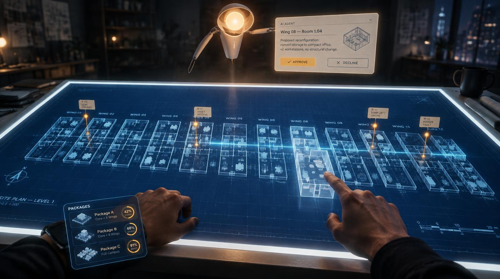

# VR Light Table: bp at a backlit drafting table

*The target. A generated concept image, not a render of anything that exists. Its labels are
image-model text and mean nothing; the build uses Kettle's real names.*

## The idea

You stand at a waist-high, backlit light table in a dark studio at night and look down at a whole
software product. bp's drawing set lies on the glass as a blueprint: wings left to right in the
order their work began, each wing's rooms rising off the paper as thin translucent extrusions,
features as small fixtures inside. A scan line sweeps a wing and amber survey pins rise where it
finds something. Your left wrist carries the wave composer: packages of findings, each with a model
and an effort. Above the far edge of the table hangs the agent, a drafting lamp with a warm head,
and beside it floats the one decision it needs from you, approve or decline. You talk to it.

This is bp's third channel after the web canvas and the phone view: the same product, model,
lenses, scans and waves, drawn for a headset.

## Decisions that shape everything (spark `vr-light-table`, 2026-10-20)

| Decision | Chosen | Rejected |
|---|---|---|
| Runtime | **Unreal Engine 5.8 + Meta XR v207**, installed by `apps/vr/tools/install-xr.ps1` | WebXR inside bp; Unity 6 |
| Sharing | bp becomes a **monorepo**. The logic lives once, in TypeScript (`packages/core`), and a headless server serves it; the UE app is a thin renderer and interaction client. Each channel keeps its own stack and dev loop | Porting the core to C++ (two copies of every rule); hybrid layout port |
| Quality bar | **PC-tethered** Quest 3 (Link / Air Link) rendered by the GPU workstation | Standalone Quest; two tiers from day one |
| Agent | **The Athena daemon itself**: its voice socket (local Kokoro TTS, Whisper), the AUTO/GATED gate, decision cards and ledger. bp registers its actions as tools | Re-implementing the gate in bp |
| Generation | Local, on the GPU box: look-dev style frames, 3D props via image-to-3D, studio environment and materials, the agent's voice | Cloud generation by default |
| Execution | Agent sessions on the GPU box drive UE through UE 5.8's editor MCP toolsets plus pof's gap-fillers; ComfyUI and TRELLIS.2 run as local services; the owner judges in the headset | An owner-only editor roadmap |
| Build host (owner, 2026-10-23) | **Lynx only** (Windows 11 on ARM64, RTX Spark N1X, UE 5.8.4 run as emulated x64). Wolf is retired; the live plan is [`lynx-plan.md`](lynx-plan.md) | Wolf, the x64 box ([`wolf-plan.md`](wolf-plan.md), kept as the record) |
| Headset, for now (owner, 2026-10-23) | **The Meta XR Simulator v207**; the headset route on ARM64 is a later decision | Quest Link in this phase (Meta lists Intel and AMD CPUs only) |
| Schema headers in UE (owner, 2026-10-23, R1) | **The git-ignored junction** `apps/vr/Source/BpLink/Public/Schema` to `packages/schema/generated/ue`, one include path | A generated copy; moving the source into `apps/vr` |
| The 90 Hz bar (owner, 2026-10-23, R5) | **p50 at or under 11.1 ms**, GPU and game thread; p95 and max reported | p95 as the bar |

## The documents

- [`tech-stack.md`](tech-stack.md): the research. Runtime, monorepo layout, the server contract,
  the Athena integration, the local generation stack with VRAM and licences, the GPU box spec,
  and the registry subjects consulted.
- [`art-breakdown.md`](art-breakdown.md): the target image taken apart element by element, each
  with how it is built (from data, procedural, generated, or shader), and the style block that
  locks the look.
- [`plan.md`](plan.md): seven phases with gates, work packages and acceptance, the fidelity
  method that measures a capture against the target, risks, and the steps only the owner can do.
- [`lynx-plan.md`](lynx-plan.md): the live execution plan on Lynx (from 2026-10-23): setup, run order from WP3.1
  to P7, the merge gates, the known gaps and the open asks.
- [`headset-plan.md`](headset-plan.md): the route to the owner's Quest 3S on Lynx (ARM64), the code to change
  first (seated calibration), and the session script and record (2026-10-26).
- [`machine.md`](machine.md): the build host's measured facts and readings 1 to 14.
- [`wolf-plan.md`](wolf-plan.md): the retired Wolf plan (2026-10-23), kept for its readings and history.

## Status

Planned, not started. Nothing in this folder is built. Execution happens on the GPU workstation;
this checkout only holds the plan.

> **2026-10-23 (owner).** Lynx is the only build host, and the GPU workstation this folder names; Wolf is retired. The
> text above was written on 2026-10-20 and is out of date: milestone 1 is judged met (plan.md), P4's assets are
> made (the import is deferred), L5.1 to L5.3 are done, and BpLink has built and printed the Kettle line in a probe
> project outside the repo (`machine.md` reading 14). `apps/vr` still has no `.uproject`. What runs next, and in what
> order, is [`lynx-plan.md`](lynx-plan.md).
