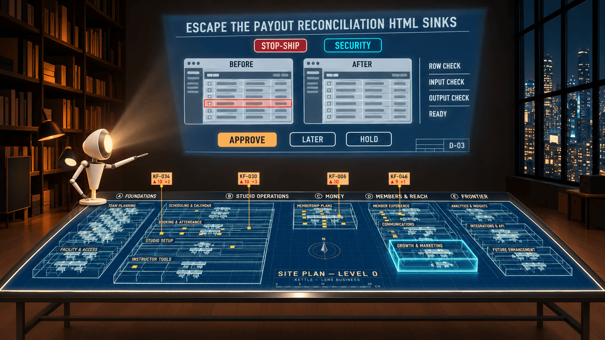
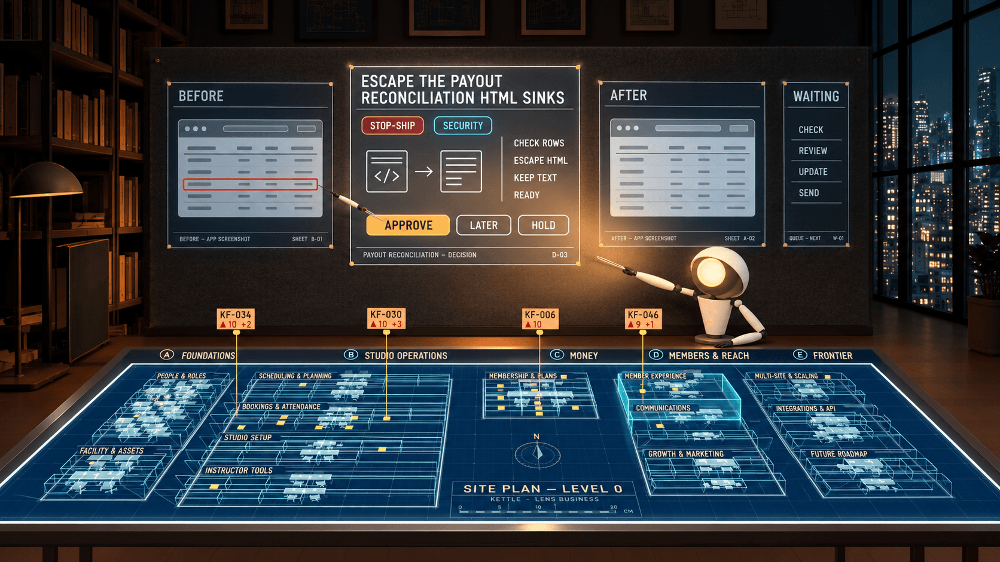
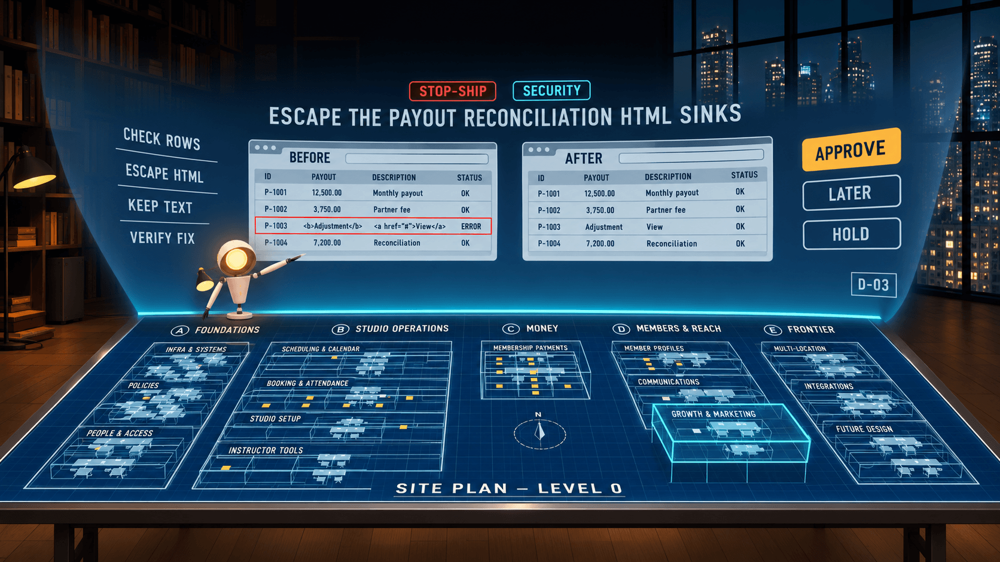

# The projector: three concepts for the main screen

The owner on 2026-11-10, after wearing the Quest 3S on that day's build: the main control screen in front of the eyes is the biggest visual gap. Once screens and visualisations sit inside it, the content cannot be read. He asked for a more projector-like screen: further from the eyes, behind the companion, larger, with room for all the content. Glim could then react to the projection as well as to the blueprint.

Today the console is a 40 x 22.5 cm panel 75 cm from the eyes, just above the table's far edge. It spans about 30 x 17 degrees, and a 1280 px finding screenshot inside it is about 12 cm wide, which nobody can read. The three concepts below each show the same moment. Glim presents decision D-03, "Escape the payout reconciliation HTML sinks", with its BEFORE and AFTER screens. The table glows in the foreground with one room lifted.

These are concept images, not shipped assets. The Codex CLI's built-in image generation made them (codex-cli 0.166.0, the same call as `scripts/fixtures/kettle-finding-shots.mjs`), with a real capture of the studio from the seat attached as a reference. `manifest.json` records every attempt, its prompt and the kept files.

**Shared numbers.** All three concepts use these figures.
- **Eye and table.** The eye is 115 cm above the floor. The table top is at 72 cm. The seat is at the table's near edge, so the far edge is about 1.35 m from the eye. The sight line over the far rim falls 43 cm per 1.35 m: at 2.2 m it is 45 cm above the floor, at 2.6 m 32 cm, and at 3.0 m 19 cm. Any sheet whose bottom edge is above those heights sits wholly above the far rim from the seat, so the table is never hidden.
- **Legibility.** Cap height = d x tan(arc minutes / 60 deg). For 40 arc minutes the factor is 0.01164, and for 60 arc minutes it is 0.01746.
- **Targets.** A 2 degree target is d x 0.0349 wide. A far ray held in the hand jitters by about 1 degree, so 2 degrees is the floor and 3 degrees is comfortable.
- **Screenshots.** The Quest 3S shows about 19 px per degree at the centre of the view. A 1280 x 720 screenshot shown 15 degrees wide gets about 290 display px, which is enough to show its structure but not its words. Each concept therefore adds a **detail crop**: the broken row of BEFORE, enlarged about 3x, as its own panel. Glim points at the crop, not at the full screen.
- **Projected look, cheaply.** Each sheet is an unlit, opaque quad in pale-ink-on-blueprint-blue, with a 2 to 4 cm alpha vignette on its edges for a soft projected edge. There is no glass, gloss or bloom.
- **Glim's projecting state.** The lens goes from warm amber to cool white at 1.3x intensity. A sheet change is a 120 ms dip of the lens and the sheet together, like a carousel slide change. Each projection zone publishes a world-space anchor (its UV rectangle mapped to a point and a normal), so Glim's head and arm can aim at the zone the voice line is about.

## Concept 1: THE THROW

**Geometry.** One sheet 240 x 135 cm stands 3.0 m from the eye on the studio's back wall, or on a virtual wall plane at that distance. Its centre is 135 cm above the floor, 20 cm above the eye, so the eye looks up about 4 degrees. It faces the seat and is keystoned by 4 percent, the top wider than the bottom, so it reads as thrown light. It spans 44 x 25 degrees. Its bottom edge is at 67 cm, well above the 19 cm sight line, so it sits clear above the far rim. Glim stands on the table's far-left corner, about 105 cm left of centre and 120 cm forward. The beam starts at his lens, about 30 cm above the table, and widens to the sheet's corners.

**Layout.** Measurements are in cm on the sheet. At 3.0 m, body caps are 3.5 cm (40 arc minutes) and titles 5.2 cm (60 arc minutes). The sheet uses a 6 cm margin.
- **Title band (228 x 18).** Title caps 6 cm, chips 4 cm caps, sheet number top right.
- **Screens.** Two screens of 80 x 45 (16:9) with a 6 cm label band each ("BEFORE", "AFTER", 3.5 cm caps), side by side, 6 cm apart.
- **Fact column (50 x 60).** Four lines, 3.5 cm caps. The detail crop (50 x 20) sits under it.
- **Control row (228 x 20).** APPROVE, LATER and HOLD as 45 x 14 cm buttons, which is 8.6 x 2.7 degrees, beyond the 10.5 cm minimum.
- **Title block (36 x 12).** Bottom right.

**Four states.**
- **Menu.** The eight menu tiles become a 4 x 2 grid of 52 x 30 cm tiles, each title in 5 cm caps.
- **Decision.** As drawn.
- **Conversation.** Glim's line becomes a 4.5 cm caption band across the top. Below it the last three exchanges sit in 3.5 cm body type, and a LISTENING strip and its level meter run across the control row.
- **Scan result.** The tallies sit as four large numerals in the title band, the findings as rows 12 cm tall (title plus room, chip at right), and DECIDE THEM in the control row.

**Glim.** Glim is the projector. He turns from the table to the wall (a 0.6 s head turn) as a sheet opens, and turns back to the table when the person reaches into it. His lens stays on the sheet while it is up. To point at a zone he swings the beam's hotspot: a 30 cm brighter ellipse moved across the sheet, which costs no new geometry. When he has to point at the table, the sheet dims to 60 percent and holds.

**Operation.** The far ray and pinch select buttons of at least 10.5 cm, and every control in the layout is 14 cm or more. The wrist carries the near remote: APPROVE, LATER, HOLD, PREV and NEXT for the sheet that is up. The pad on the table's near-left mirrors the sheet's controls at reading distance. NEXT and PREV also go on the right stick, as today.

**Cost (Quest 3S, 72 fps).**
- **Sheet.** One unlit opaque quad and one widget render target. 44 degrees at about 37 px per degree (2x supersampled) gives 1600 x 900, 5.8 MB RGBA8, redrawn only on change.
- **Screenshots.** They are textures inside the widget. No new draws.
- **Beam.** Two crossed additive quads from lens to sheet, alpha 0.06 or less, about 4 percent of the screen. Overdraw is negligible. No volumetric fog.
- **Passthrough ("your room").** There is no wall. The sheet stays at 3 m as a free-standing sheet with a 90 percent opaque dark backing quad, and the beam is turned off, because a beam that lands on nothing reads as a bug.

**Risk.** In passthrough the projector conceit needs a real wall, and without one it degrades to a large floating screen.

## Concept 2: THE PIN-UP WALL

**Geometry.** A dark felt tackboard 340 x 110 cm stands 2.6 m from the eye. It is the back wall dressed as a board, or a free-standing board in passthrough. Four sheets are pinned to it with their tops aligned 185 cm above the floor:

| Sheet | Size (cm) | Angle |
| --- | --- | --- |
| BEFORE | 75 x 50 | 16 deg |
| DECISION, centre and largest | 95 x 70 | 21 deg |
| AFTER | 75 x 50 | 16 deg |
| WAITING | 35 x 70 | narrow |

The gaps are 8 cm. The whole set spans 304 cm, about 61 degrees. The decision's centre is 150 cm above the floor, about 7.5 degrees above the eye. The lowest sheet bottom is at 115 cm, far above the sight line. Glim stands on the table's far-right corner, below AFTER. His light is a soft pool on the active sheet, with no visible beam.

**Layout.** At 2.6 m, body caps are 3.0 cm and titles 4.5 cm. A 2 degree target is 9.1 cm.
- **DECISION.** Title in two lines of 5 cm caps, chips, four fact lines in 3.0 cm caps, the detail crop (40 x 15), and APPROVE, LATER and HOLD at 26 x 11 cm each. The title block is a 6 cm strip at the foot.
- **BEFORE and AFTER.** Each is a 75 x 42 screenshot with an 8 cm label strip.
- **WAITING.** Five items in 3.0 cm caps, each 11 cm tall so each one is a target.

**Four states.**
- **Menu.** One sheet per menu group: ROOMS, SCAN, STAND-UP, ASK. The centre sheet is the menu itself, with MENU tiles 40 x 14 cm.
- **Decision.** As drawn.
- **Conversation.** The centre sheet holds the transcript. The side sheets keep whatever Glim refers to: a room plan, a finding, a screenshot. This is the concept where Glim "pins up" what he talks about.
- **Scan result.** The centre sheet holds the tallies and DECIDE THEM. Left and right are the stop-ship and before-release lists. WAITING holds the later items.

**Glim.** The active sheet is at 100 percent brightness, its neighbours at 55 percent and WAITING at 35 percent. Glim's attention is the light: he turns his head to a sheet, and that sheet brightens over 250 ms. He walks the far rim between the table's corners, two hops, to stand under the sheet he is talking about, and points with his arm at the zone anchors. When the person picks a sheet with the ray, Glim turns to it as well.

**Operation.** The ray and pinch work on any sheet. Pinching a dim sheet makes it active, and pinching it again brings it to the centre slot, which swaps the sheets. The buttons sit only on the centre sheet, at 26 x 11 cm, or 5.7 x 2.4 degrees. The wrist and the pad act on the active sheet.

**Cost.**
- **Draws.** Four unlit opaque quads plus the board quad.
- **Render targets.** Only DECISION and WAITING are widgets: 820 x 600 and 300 x 600 at about 37 px per degree. BEFORE and AFTER are plain textured quads of the 1280 x 720 shots, with no widget at all.
- **Light pool.** A material parameter per sheet (an emissive scale), not a light. No translucency except the edge vignettes.
- **Passthrough.** The board becomes a free-standing quad at 2.6 m and still reads as a board, because it is an object, not a wall.

**Risk.** At 61 degrees the outer sheets need a head turn of up to 30 degrees, and four sheets mean the layout of every state must be designed four ways.

## Concept 3: THE LIGHT STAGE

**Geometry.** A cylinder segment, radius 2.2 m, centred on the eye. It is 130 cm tall, and its base runs at table height (72 cm), just behind the far rim, where a 1 cm cyan line of light runs the full rim as the "slot" it rises from. The base clears the 45 cm sight line, so the stage reads as rising out of the rim. The top is at 202 cm and fades out over its last 25 cm.

The arc is 120 degrees, 4.6 m along the curve, but content is kept to the central 80 degrees. The two outer 20 degree ends are dim atmosphere only. Vertically the stage spans -11 to +22 degrees, and its centre is 137 cm above the floor, about 6 degrees above the eye. Glim stands on the far rim just left of centre, at the foot of the stage, and casts no beam: the stage is the light.

**Layout.** On a 2.2 m radius, 1 degree is 3.84 cm of arc. Body caps are 2.6 cm, titles 3.8 cm, and a 2 degree target is 7.7 cm.
- **Centre zone, ±25 degrees (192 cm).** Chips, title in 5 cm caps, BEFORE and AFTER at 85 x 48 each with label bars, and the detail crop below them.
- **Left zone, -25 to -40 degrees (58 cm).** The fact lines.
- **Right zone, +25 to +40 degrees (58 cm).** APPROVE, LATER and HOLD stacked, 50 x 14 cm each, 7.5 x 2.1 degrees.
- **Title block.** Bottom right of the right zone.

**Four states.**
- **Menu.** The eight tiles run across the central 80 degrees as one row of 22 x 40 cm columns. The far ends show the project name (left) and the hour (right).
- **Decision.** As drawn.
- **Conversation.** Glim's line sits large in the centre (5 cm caps). The transcript scrolls in the left zone, and the LISTENING meter runs along the cyan rim line itself.
- **Scan result.** The tallies sit centre, the findings rows across the centre and right zones, and DECIDE THEM in the right zone.

**Glim.** Glim stands at the stage's foot like a presenter. He turns up to it (a 25 degree head pitch) and points at zone anchors along the curve. He walks the rim left or right to stay under the zone he is talking about. The rim line brightens under him. When the stage closes it sinks into the rim line over 400 ms, and Glim turns back to the table.

**Operation.** The far ray works on the curve as on a flat sheet. Every control sits within ±40 degrees, so no head turn past 40 degrees is needed. The wrist and the pad carry the controls, as in the other concepts.

**Cost.**
- **Geometry.** One widget component in Unreal's cylinder geometry mode (`EWidgetGeometryMode::Cylinder`, arc 80 degrees) for the content. One unlit cylinder strip for the faded ends and top (24 segments). One thin additive line mesh for the rim.
- **Render target.** 80 x 33 degrees at about 30 px per degree gives 2400 x 1000, 9.6 MB. Use one render target, redrawn on change. Do not split it further unless profiling says so.
- **Translucency.** Only the faded top and ends, about 8 percent of the view.
- **Passthrough.** The stage needs no wall, so it works unchanged. The faded ends let the real room show around it.

**Risk.** A wide wrap-around stage at 2.2 m competes with the window wall and the table for attention, and the outer 20 degrees on each side are wasted fill-rate unless they earn a job.

## What the images got wrong

- **Camera.** The generator drew all three from higher than the seated eye (closer to 60 to 70 cm above the table, not 43). The table therefore reads deeper and its far edge sits lower in the frame than it would from the seat.
- **Text.** The table's wing and room labels are invented (FUTURE ROADMAP, POLICIES, and so on). Treat the words as placeholders: the layout is what counts.
- **Throw.** Glim points with his arm rather than turning his whole head to the wall.
- **Pin-up.** The generator replaced the decision sheet's screenshots with a code-to-text icon. That fits the design, since BEFORE and AFTER are their own sheets.
- **Stage.** The stage reads as about 100 degrees, not 120.

## Comparison

| | 1 Throw | 2 Pin-up | 3 Stage |
| --- | --- | --- | --- |
| **Legibility** (body cap 40 arc minutes) | 3.5 cm at 3.0 m. One sheet, the eye stays still | 3.0 cm at 2.6 m. Best for screenshots: each gets its own sheet | 2.6 cm at 2.2 m. Closest, so the smallest type, but the most area |
| **How it uses the space** | One 44 degree sheet above the table: the room is the cinema | 61 degrees of sheets: the most content at once | 80 degrees of content in a 120 degree wrap: the most immersive |
| **Glim's role** | The projector: his lens is the source, his hotspot is the pointer | The reviewer: he walks to and lights the sheet he is talking about | The presenter: he stands at its foot and points up |
| **Cost** | Lowest: 1 quad, 1600 x 900 render target, a 2-quad beam | Low: 4 quads, 2 small render targets, 2 plain textures | Medium: 1 cylinder widget at 2400 x 1000, plus translucent ends |
| **Risk in passthrough** | High: no wall for the throw, the beam turns off | Low: the board is an object | None: needs no wall |

## Recommendation: the order to prototype

1. **THE THROW, first, today.** It is one quad and the current console widget re-laid out at 240 x 135 cm. It answers the owner's question (is far and large legible?) for the least work, and the beam and hotspot give Glim his "react to the projection" role at once.
2. **THE PIN-UP, second.** It is the throw's sheet split into four quads on the same pipeline. It is the best answer for screenshots, and it makes "use the space" literal. Prototype it once the throw has shown the right distance.
3. **THE STAGE, third.** It is the passthrough-proof one and the most striking, but it carries the most comfort and fill-rate questions. Build it as the passthrough fallback if the throw's floating sheet in "your room" feels wrong.
