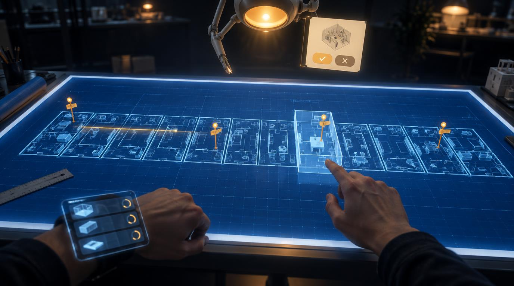
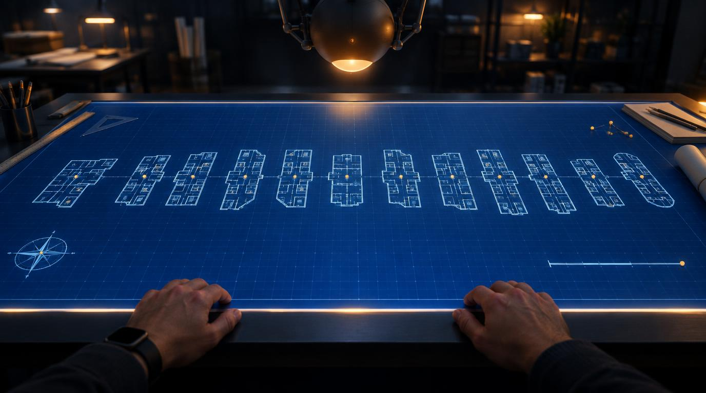
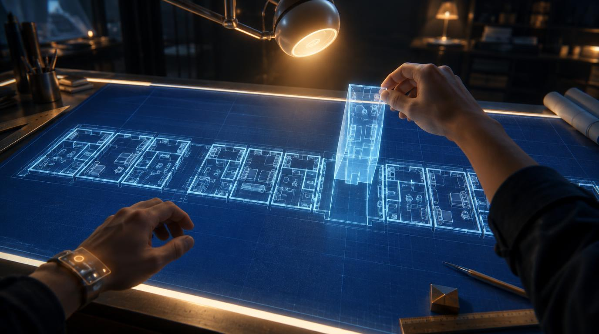
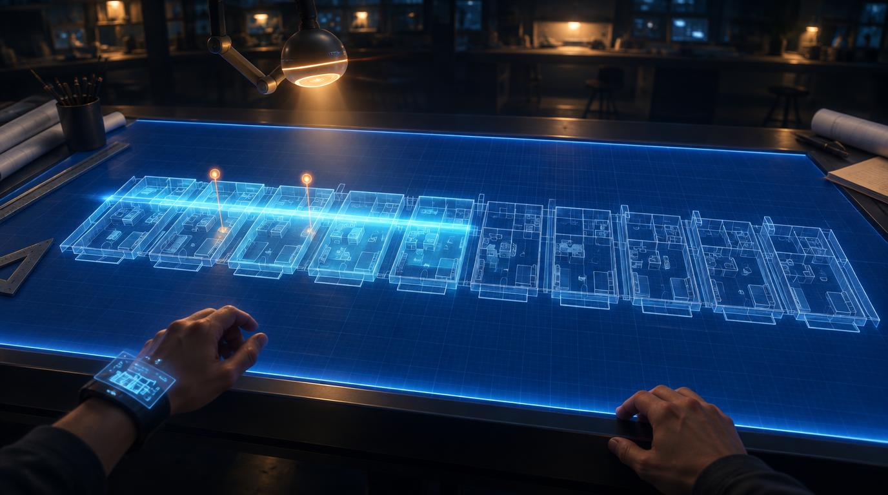
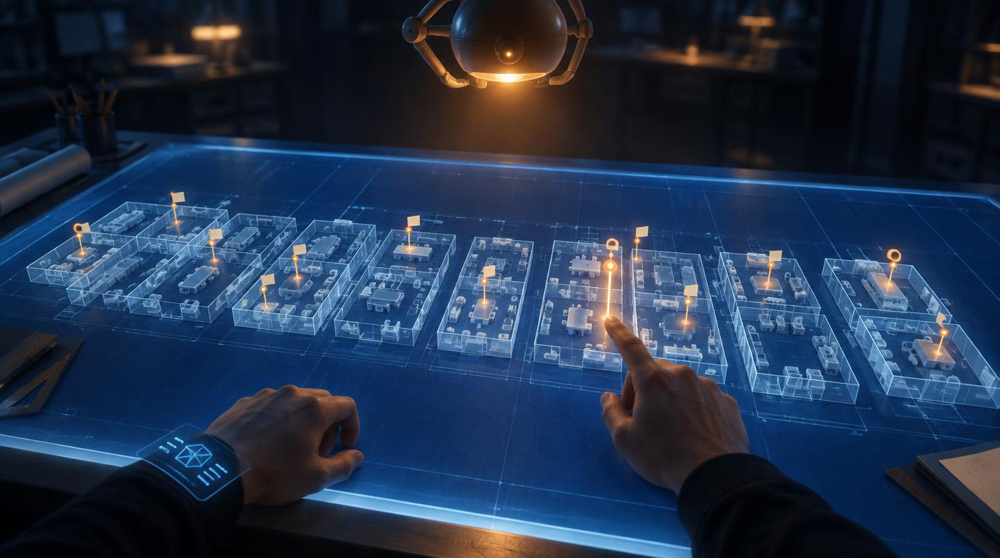
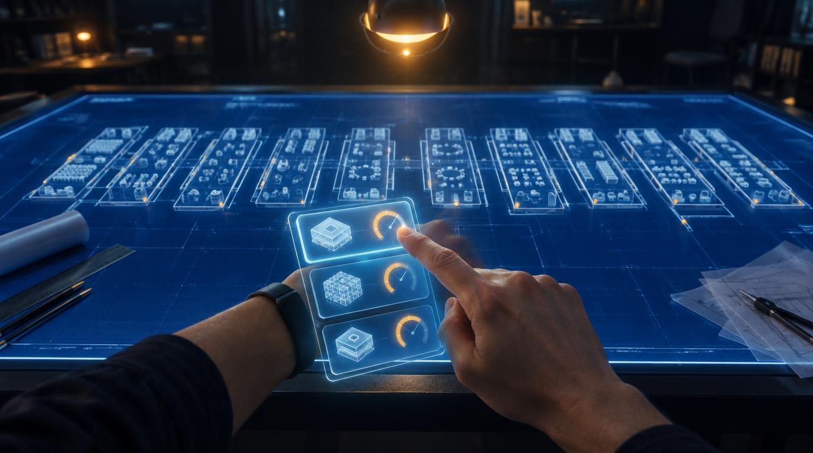
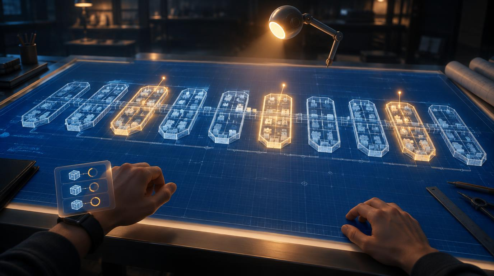
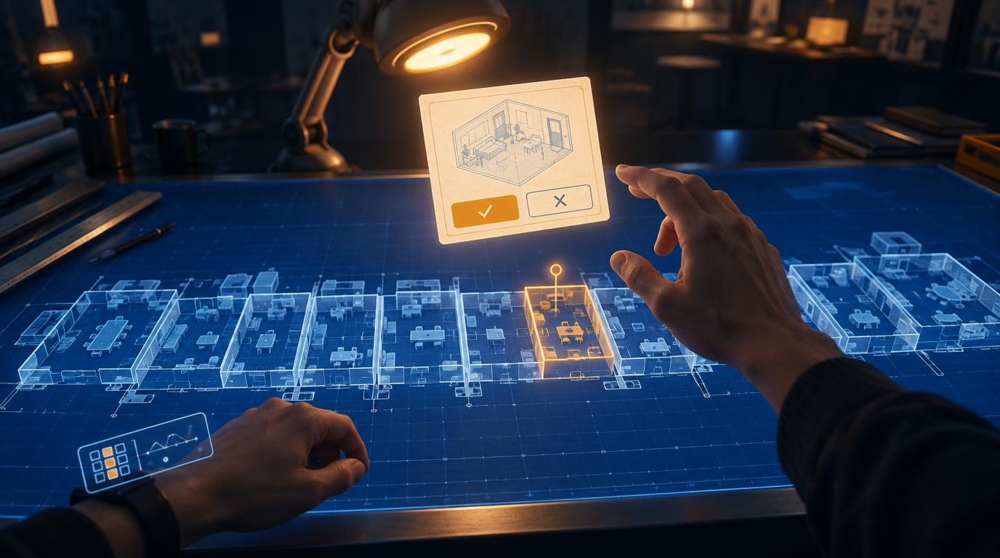
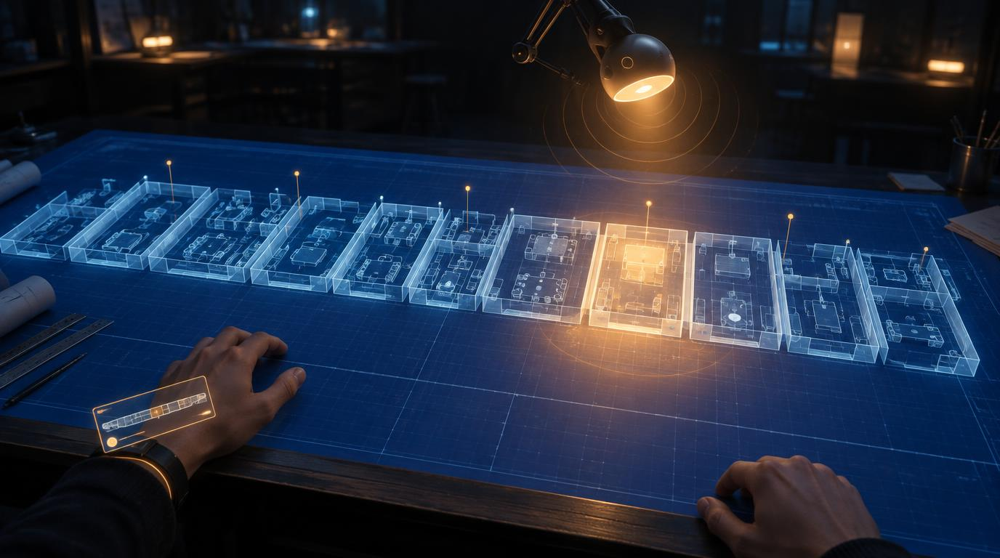

# VR Light Table: P2 look-dev reference sheet

The P2 gate in `plan.md`: the owner approves one reference sheet (the target plus a frame for each state),
and it becomes the art bible for P3 to P6. This sheet was produced on 2026-10-20 with the Leonardo API
(`openai/gpt-image-2.5-flare`, style id `111dc692-…`, 1376×768, `prompt_enhance` OFF, every call
`"public": false`).

How the frames were made:

- **Style block.** `lookdev/style-block.json` is the style block from `art-breakdown.md`, plus a subject lock
  added after the Director's test drew a campus: *the plan is the wings, rooms and fixtures of a software
  product, drawn as an architect's site plan; no buildings, no trees, no landscape, no readable text or labels.*
  `scripts/lookdev/leonardo.mjs` appends the whole block to every prompt.
- **States.** `lookdev/states.json`. `00-hero` is the operator's hero prompt word for word. Each of the other
  eight is derived from it by changing only what that state shows. **Variant a** is the state text plus the
  block. **Variant b** starts with the state's focus and a pose lock (standing eye height, pitched about 45°
  down at the near edge, lamp in the upper third), then gives the same text.
- **Trial matrix.** At LOW, each of the 9 frames got 2 variants × 2 seeds (1001, 2002): 36 calls. Every
  LOW frame was graded 0 to 3 (appendix). The best pick per state was then re-rendered at MEDIUM. Where the
  MEDIUM draw came out worse than its LOW pick, it was redrawn once more with seed 3003.
- **Grades** use the P6 fidelity scale: 0 missing, 1 placeholder, 2 reads as the concept, 3 matches the
  concept. They are the builder's first pass, as advice for the owner.
- Every call (full prompt, seed, quality, generationId, credits, file) is a line in `lookdev/log.jsonl`.
  `lookdev/picks.json` maps each pick to its call.

Seeds do **not** carry across quality. A MEDIUM render with the LOW pick's seed and prompt is a new
composition, not a sharper copy. So a MEDIUM frame was graded again on its own.

## The target

## The hero frame

| Quality | Variant | Seed | Grade |
|---|---|---|---|
| MEDIUM | a (the operator's prompt verbatim + block) | 1001 | 3 |

Every element in the hero prompt is present: a backlit table with a white edge light, about a dozen wings
with rooms and fixtures, the room under the finger raised, pins with tags, a scan line, a lamp agent with a
warm head, a paper card with an amber approve button and a grey decline button, and a wrist panel with
three trays, chips and dials.

What still misses the concept:
- The raised room is low and dim, nothing like the target's tall bright bay.
- The scan line is amber, where the target's is cyan (see the open questions).
- The lamp hangs from above on a jointed arm that ends in a claw. It reads as a robot more than a
  drafting lamp.
- The pin tags carry tiny glyph marks: not readable, but not blank either.
- No night city through windows (element 14). The prompt didn't ask for one.

## 01 · L0 at rest

| Quality | Variant | Seed | Grade |
|---|---|---|---|
| MEDIUM | a | 2002 | 2 |

This frame gets right: a flat sheet with 12 wing footprints in a row, a pin dot at each wing, a compass
rose and a scale bar, hands relaxed on the near edge, no scan line and no card. It is the calmest frame.

What still misses the concept:
- The wings come out as boat-hull and tablet outlines, not footprints made of rooms. This happened in all
  six L0 draws, so the prompt wording is the likely cause.
- The lamp is a dark sphere on spider legs: it looks ominous rather than calm.
- The edge light is a thin warm strip, not the target's bright white frame.
- The wrist panel is gone, leaving only a dark watch. That fits "idle", but the element is lost.
- Alternate: `lookdev/01-l0-rest-alt.jpg` (seed 3003, grade 2) has cleaner wings and an even heavier lamp.

## 02 · A room lifted (L2 to L3)

| Quality | Variant | Seed | Grade |
|---|---|---|---|
| MEDIUM | a | 3003 (retry) | 3 |

This frame gets right: the right hand pinch-pulls one room up into a tall translucent bay with fixtures
inside and bright cyan edges. The rest of the plan stays flat. The lamp sits on a real jointed arm, and the
table has a bright edge light.

What still misses the concept:
- The plan is one long strip of rooms, not separate wings with gaps between them.
- The wrist panel is a band with a single dot: no trays.
- The lamp faces down at the table rather than at the lifted room.
- Alternate: `lookdev/02-room-lifted-alt.jpg` (seed 1001, grade 2): the strip problem is worse, and the lamp
  is a multi-armed pendant.

## 03 · A scan sweeping

| Quality | Variant | Seed | Grade |
|---|---|---|---|
| MEDIUM | a | 2002 | 3 |

This frame gets right: a bright cyan band sweeps along the row, the rooms it has passed keep an afterglow,
and two amber pins rise behind it. The lamp, on a jointed arm, follows the band, and the edge light is
strong.

What still misses the concept:
- The band crosses five wings at once instead of sweeping one wing (`art-breakdown.md` #8).
- The lamp sits in the upper left, not the upper third centre.
- The wrist panel shows a small floor plan rather than the composer.

## 04 · Pins risen

| Quality | Variant | Seed | Grade |
|---|---|---|---|
| MEDIUM | b | 3003 (retry) | 3 |

This frame gets right: about twenty amber survey pins with blank paper tags stand at fixtures across every
wing, each with a small warm glow. The pin under the finger is bigger and brighter, and the wings are
distinct.

What still misses the concept:
- Twenty pins is too many: the target has four, and the plan asked for "a dozen". A real scan will vary.
- The lamp is a dome pendant on two struts. It doesn't look toward the pins.
- The fixtures are blocky white bricks, not the target's fine furniture.
- Alternate: `lookdev/04-pins-risen-alt.jpg` (seed 1001, grade 2): its lamp is a spider-like sphere.

## 05 · The wrist composer with three packages

| Quality | Variant | Seed | Grade |
|---|---|---|---|
| MEDIUM | a | 1001 | 3 |

This frame gets right: the left forearm is raised, and a crisp glass panel shows three stacked trays, each
with a model chip and an amber effort dial. The right index finger touches the top tray, and the plan sits
softly behind.

What still misses the concept:
- The panel floats over the back of the hand like a phone held up. In the target it is anchored at the
  wrist.
- The far edge of the sheet has faint title-block glyphs. Not readable, but the block says none.
- The lamp is a dome pendant cropped at the top edge.

## 06 · A wave running

| Quality | Variant | Seed | Grade |
|---|---|---|---|
| MEDIUM | a | 2002 | 3 |

This frame gets right: three separate wings glow amber-white while the rest stay cyan. The wrist shows
three trays with progress rings, and the lamp, on a jointed arm, turns toward the busy wings.

What still misses the concept:
- The wings are rounded capsules, not rectilinear footprints.
- A pin rises from each busy wing. The prompt asked for none: it confuses "working" with "finding".
- The progress rings are all at about the same fill, so they don't say how far each package has got.

## 07 · A decision card asking

| Quality | Variant | Seed | Grade |
|---|---|---|---|
| MEDIUM | b | 2002 | 3 |

This frame gets right: a warm paper card floats toward the viewer with a sketch of the room, a filled amber
approve button and an outlined decline button, and no text. The room it asks about is outlined amber on the
sheet, with a pin. The right hand reaches to pinch, and the lamp leans in on a jointed arm.

What still misses the concept:
- The lamp stands on the table as an ordinary desk lamp. The target's agent hangs above the far end.
- The plan is a continuous strip on the left and breaks into boxes on the right.
- The wrist panel shows a grid and a chart, not trays.

## 08 · The lamp speaking

| Quality | Variant | Seed | Grade |
|---|---|---|---|
| MEDIUM | b | 2002 | 3 |

This frame gets right: the lamp's head on its jointed arm glows, and soft amber ripples breathe out from it.
The head points down at one wing, which sits in a warm pool of light while the rest of the plan stays cool.
This is the clearest reading of the agent of any frame.

What still misses the concept:
- The ripples read slightly as sound waves (a UI trope). A softer pulse may be closer to "calm".
- The lamp sits right of centre.
- The wrist panel is a thin bar with no trays.

## Across all frames

- **The lamp agent (element 9) is the weakest element.** Across 48 draws it came out as a pendant dome, a
  sphere on spider legs, a robot with claws, a humanoid mannequin (07 a/2002), or a lamp with a cartoon face
  (04 a/1001, 07 b/1001, 05 a/2002). "Drafting-lamp-like presence" reads best when the prompt names a
  **jointed arm** (06, 08). P4's prop sheet for the lamp should pin the design down before any more style
  frames.
- **The subject lock held.** No buildings, trees or landscape appeared in 48 draws. One LOW frame
  (05 b/1001) drew fixtures that read as city blocks.
- **No readable text.** A few frames have glyph-like marks on tags or the title block.
- **The pose held.** Every frame is first-person, standing, looking down at the near edge, with the lamp in
  the upper part of the frame.
- **The wrist panel drifts.** Unless a state names the trays, the panel turns into a generic smartwatch UI.

## Appendix: LOW trial matrix grades

Seeds 1001 and 2002, each with variant a and variant b. All 36 frames are in `lookdev/explore/` (each is
under 400 KB). ★ marks the pick re-rendered at MEDIUM.

| State | a / 1001 | a / 2002 | b / 1001 | b / 2002 |
|---|---|---|---|---|
| 00 hero | ★3: amber scan line; lamp cropped, robot legs | 2: lamp is a ceiling pod | 2: lamp is a stick puppet with hands | 2: best lamp, but room barely raised |
| 01 L0 | 2: hull-shaped wings; lamp a dark dome | ★2: compass, scale bar, edge glow; lamp a sphere pendant | 2: hull-shaped wings; lamp a spotlight | 2: hull shapes; table not lit |
| 02 room lifted | ★3: bay with fixtures, separate wings; lamp a crab pod | 2: plan is one strip; lamp has claws | 2: one strip; bare glass box | 2: one strip; claws |
| 03 scan | 2: band crosses the whole row; boxy volumes | ★3: cyan band, afterglow, two pins | 2: band on one wing (correct) but faint | 2: band and pins fine; plain desk lamp |
| 04 pins | 2: lamp has a cartoon face | 2: pins tiny; lamp is a pod robot | ★3: tagged pins, pointed pin bright, edge light | 2: pins read as golf flags |
| 05 wrist | ★3: three trays, chips, dials, finger on top tray | 2: lamp has a face; panel held like a phone | 2: fixtures read as city blocks | 2: panel as cards over the fist |
| 06 wave | 3: three amber wings; jointed lamp | ★3: three amber wings, light threads, rings | 2: wings shaped like Tetris pieces | 2: ceiling-fixture lamp |
| 07 decision | 3: card, amber room, reach; lamp on spindly legs | 2: lamp is a humanoid mannequin | 2: lamp has a cartoon face | ★3: drafting lamp, card, pinch |
| 08 lamp speaking | 2: ripples lie on the paper like water | 3: jointed arm, ripples, pool of light | 3: clean ripples, one wing lit | ★3: tightest composition, lamp near centre |

## Open questions for the owner

- **Scan line colour.** The element table (#8) and the target say cyan. The style block puts "scan" in the
  amber attention role. Every LOW hero draw painted the scan amber, and 03 painted it cyan because its text
  says cyan. One of the two docs should change; this sheet doesn't pick.
- **The lamp design.** See "Across all frames". Lock it in a P4 prop sheet, or a second look-dev pass,
  before P3 uses these frames as the art bible?

## Spend

| Quality | Calls | Credits each | Credits |
|---|---|---|---|
| Director's test (LOW, before this log) | 1 | 6 | 6 |
| LOW (trial matrix) | 36 | 6 | 216 |
| MEDIUM (9 picks + 3 retries) | 12 | 14 | 168 |
| HIGH | 0 | n/a | 0 |
| **Night total** | **49** | | **390 of the 400 cap** |

The API reported the cost of every call itself (`creditsSource: "api"` in the log). No call failed. HIGH
was never probed, since the MEDIUM picks and retries used the budget down to the 390 guard. No state is
left at LOW, and none is missing.

Owner approval: pending
